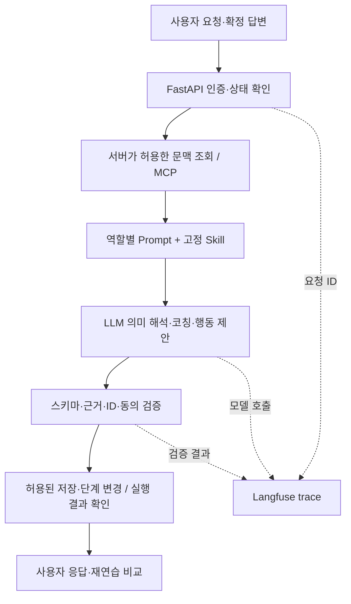

# 말해봄 에이전트 구현·평가 리포트

작성일: 2026-10-09 · 운영 대조 및 갱신: **2026-10-10**. 신입 백엔드 면접 준비 에이전트의 목적, 처리 구조, 기존 평가 결과와 운영 검증 범위를 정리한다. 상세 설계는 [ARCHITECTURE](ARCHITECTURE.md), LLM 실험은 [EVAL_REPORT](../EVAL_REPORT.md)가 기준이며 이 문서는 두 자료를 연결하는 종합 리포트다.

## 1. 요약

말해봄은 사용자가 제출한 자료와 확인한 답변을 바탕으로 면접 준비·코칭·재연습과 확인된 경험의 이력서 초안 정리를 돕는다. LLM이 요청의 의미와 코칭 문장을 생성하고, 서버가 권한·동의·상태 변경·저장·출력 검증을 책임지는 구조다. 사용자 경험을 사실 인증하거나 합격 가능성을 판정하지 않는다.

구조화 출력과 제한된 서비스 실행 경로는 구현·검증 근거가 있다. 그러나 계약 통과와 예외 미발생은 응답 품질·기능 실행 성공과 다르다. 과거 코칭 반복 평가에는 판정 회귀가 남았고, 최신 출력의 사람 품질 평가와 실제 마이크부터 시작하는 전체 사용자 E2E는 별도 검증이 필요하다.

## 2. 보고서 기준과 버전 경계

| 기준 | 확인 내용 | 해석 범위 |
| --- | --- | --- |
| GitHub main | 갱신 출발점 `dfd79bb`; 최초 보고서 기준 `fd9a6b9` | 10/10 main과 운영을 별도로 조회; 최신 운영 기능 전체가 main에 있는 것은 아님 |
| 현재 운영 | `malhaebom-mk2-custom-question-1010`, 트래픽 100% | 10/10 Cloud Run 서비스·revision 조회로 확인 |
| 배포사이트·API | 사이트·백엔드 health·OpenAPI HTTP 200; JS `index-BoubqN-2.js` | 홈·초기 연습 화면 직접 확인, 이력서 작성 보조 코드 및 API 명세 확인 |
| 과거 운영 HTTP 연결 증거 | [PR #221](https://github.com/aihuman-7th/proj2-3/pull/221), MERGED | 10/9 당시 실제 채팅 200·입력 오류 422의 ID 직접 연결 |
| 전문가 검토 메타데이터 | [PR #219](https://github.com/aihuman-7th/proj2-3/pull/219), MERGED | 사용자 확인에 따른 김창민 검토 완료 기록; 생성 출력의 새 사람 평가와 구분 |
| 과거 평가 | 아래 각 실행의 날짜·모델·Prompt·Skill·입력 조건 | 최신 운영 품질 점수로 재사용하지 않음 |

현재 이미지 digest는 `sha256:a8a5ab966d8742dede8e1400426f20035dc7d71dc2b965c12394070d1f6eca19`다. 조회 시각·트래픽·공개 환경 설정·배포 JS 해시·이력서 API·PR 병합 상태는 [10/10 증거 snapshot](evidence/agent-report-20261010.json)에 고정했다. 과거 평가의 출처·SHA256·집계는 [10/9 snapshot](evidence/agent-report-20261009.json)을 유지한다.

10/10 Cloud Run 설정의 코칭 모델은 `google/gemini-3.5-flash-lite`, managed Prompt 선택은 `malhaebom-coaching-v5-reinforced-verification`의 `production` 라벨이다. 직접 입력 질문 배포 기록은 @4 사용을 기록하지만 이번 문서 갱신에서 원격 숫자 버전·실제 로드된 전체 Skill 본문을 다시 조회하지는 않았다. mutable 라벨만으로 숫자 버전이나 과거 평가와의 동일성을 확정하지 않는다. 새 모델 평가·배포·Prompt/Skill 수정은 수행하지 않았다.

역할별 배포 기록의 LLM은 코칭 및 신규 이력서 정보 가져오기·문장 다듬기 Gemini 3.5 Flash Lite, 자유채팅 Claude Haiku 5.5, 준비 단계 README·이력서 분석 Gemini 3.1 Flash Lite, 전사 정규화 Gemini 3.1 Pro Preview의 4종이다. 이력서 작성 보조는 기존 3.5 모델의 추가 역할이며 별도의 다섯 번째 모델이 아니다. 공고 검색은 `playmcp_tavily` 경로이며 Gemini 3.8 Flash를 현재 사용 모델로 포함하지 않는다. [역할별 외부 후보 비교와 선정 근거](LLM_MODEL_SELECTION_REPORT.md)에 비용·속도·품질의 확인 범위를 정리했다. 전사 정규화 Pro는 다른 모델 비교 대신 10/8 배포사이트의 사투리 WAV 2건 보정 기능 확인을 근거로 한다.

## 3. 사용자 문제와 서비스 흐름

사용자가 어려워하는 일은 경험에서 본인 역할을 구분하고, 설명이 부족한 부분을 알아내고, 다시 답했을 때 무엇이 보완됐는지 확인하는 것이다.

1. NCS 역량을 선택하고, 이력서 PDF·README를 선택적으로 제출·검토한 뒤 지원 공고를 선택한다.
2. 질문에 답변을 녹음하고 STT 전사를 확인·수정한다.
3. 서버가 확정한 답변 revision과 공고 문맥으로 코칭한다.
4. 필요한 정보만 확인 질문으로 보완하고 다음 연습 행동을 제시한다.
5. 명시적 재답변 요청 후 같은 질문에 다시 답한다.
6. 비교 가능한 두 결과를 서버가 같은 기준으로 대조한다.
7. 비교 이후 추가 면접 대화를 이어가거나, 프로젝트·경력 중심 이력서 초안을 보완하고 문서 형식으로 재구성해 PDF로 내려받는다.

준비 중 질문과 코칭 후 대화도 지원한다. 준비 자료와 추가 진술은 참고 문맥이며, 현재 답변에 없었던 사실을 그 답변의 근거로 소급해서 사용하지 않는 것이 기본 경계다. 화면 단계 전체가 이 보고서에서 새로 E2E 검증된 것은 아니다.

### 3-1. 준비 자료와 참고정보

이력서 PDF 검토는 기술·경력·프로젝트 등 6종 정보를 추출하고 페이지·원문 인용을 보여준다. 사용자가 항목을 수정·삭제·확정한 뒤 공고 추천에 사용한다. 원래 PDF 인용과 사용자가 수정한 정보는 구분하며 이력서의 기재만으로 경험의 사실성을 인증하지 않는다. 이력서와 README는 모두 건너뛸 수 있고, 선택한 NCS와 사용자가 확인한 경험을 참고해 다음 준비 흐름을 진행한다.

채팅에서 보완한 경험은 개인 역할·확인 결과를 검토하고 반영 동의를 확인한 뒤 연습용 `reference_only` 정보로 저장한다. 근거 자료실은 **참고 자료 / 답변 근거 / 추가 확인 사항**을 나누어 이력서·README·공고·채팅 경험과 현재 답변의 인용을 표시한다. 참고 자료를 현재 답변에 실제로 말한 근거로 바꾸지 않는다.

NCS·이력서·README·공고·질문의 재선택은 해당 단계에 따라 이후 상태의 초기화 범위를 안내하고 동의를 받는다. 아직 진행하지 않은 단계는 현재 준비 순서를 안내한다. 작업 히스토리·재답변·비교 버튼과 분석 진행 상태도 화면에 표시한다. 구체적인 준비·초기화 구현은 [운영 소스 비교](evidence/production-source-sync-2026-10-09.md)를 따른다.

### 3-2. 비교 이후 이력서 작성 보조

| 동작 | 처리와 사용자 확인 |
| --- | --- |
| 초안 양식 선택 | 프로젝트 중심·경력 중심 양식을 제공하고 미확인 항목은 대괄호 빈칸으로 표시 |
| 이력서 보완 | 사용자가 기본 정보·경력·기술·개인 역할·문제·행동·확인 결과를 직접 입력·수정; 선택 항목은 비워 둘 수 있음 |
| 제출한 정보 가져오기 | 기존 PDF 또는 다시 첨부한 PDF의 원문 텍스트를 별도 동의 후 분석해 빈 항목을 채움; 원문에서 확인되지 않은 추출 항목은 제외 |
| 문장 다듬기 | 별도 동의 후 경험 설명을 정리; 사실 확인이 필요하면 해당 항목을 질문하고 답변한 항목만 재처리 |
| 원문 유지·되돌리기 | 질문을 건너뛰거나 다듬은 문장을 되돌릴 수 있고, 오류가 나면 입력한 내용을 유지 |
| 재구성·PDF | 보완한 초안을 문서 양식으로 재구성하고 브라우저에서 PDF 다운로드; 원본 PDF 파일을 덮어쓰는 기능과 구분 |

준비 단계의 추천용 PDF 분석(`/api/resume/analyze`, Gemini 3.1 Flash Lite)과 비교 이후 작성 보조(`/api/resume/assist/import`, `/api/resume/assist/polish`, Gemini 3.5 Flash Lite)는 별도 계약이다. 양식 구성·입력·PDF 생성은 프런트엔드가 담당하고, 신규 AI는 원문 정보 분류와 경험 문장 정리를 담당한다. 10/10 운영 OpenAPI에 세 API가 있고 배포 JS에 위 작성 보조 코드가 있음을 확인했다. 전체 작성·다운로드 흐름을 이번 조회에서 실행했다는 뜻은 아니다.

작성 보조의 배포 기준 소스와 검증 기록에 따르면 원본 파일·새 보완 값·사진은 화면 메모리에서 관리하며 새 가져오기·다듬기 내용은 DB/Storage/Langfuse에 저장하지 않는다. 이름·연락처·사진은 문장 다듬기 요청 필드에서 제외한다. **정보 가져오기는 개인정보가 포함될 수 있는 PDF 원문 텍스트를 외부 AI로 전달하므로 별도 동의를 받는다.** 두 경로의 전송 범위를 동일하게 설명하지 않는다.

서버는 인증·동의·입출력 스키마·원문 인용 일치를 검증하며, 문장 다듬기에는 새 수치·개인정보 패턴 검사도 적용한다. 원문 가져오기 값은 검증된 인용으로 구성하고, 문장 다듬기의 역할·기술·성과 의미 보존은 모델 지침과 사용자 최종 검토도 필요하다. 자동 재시도는 없으며 실패 시 사용할 수 없는 결과를 안내한다. 연습용 참고정보의 DB 저장과 이력서 초안의 화면 내 반영은 별개다. 근거와 이전 검증 범위는 [10/10 snapshot](evidence/agent-report-20261010.json)을 따른다.

## 4. Prompt·Skill·MCP·서버의 역할

| 구성 | 담당 | 대표 구현·근거 |
| --- | --- | --- |
| Prompt | 역할, 입력 구획, 응답 형식과 생성 절차 | [Prompt 조립](../backend/app/services/coaching_prompt.py), [규칙 소유 점검](evidence/current-prompt-skill-conflict-audit-2026-10-06.md) |
| Skill | 질문 유형별 도메인 기준, 예외와 보류, 코칭 원칙 | [interview-coach](../skills/interview-coach/SKILL.md), [criteria](../skills/interview-coach/criteria.json) |
| LLM | 의미 해석, 설명, 부족 정보·다음 행동 제안 | [코칭 runtime](../backend/app/services/coaching_runtime.py), [준비 대화 runtime](../backend/app/services/preparation_conversation_runtime.py) |
| MCP | 허용된 질문·답변·공고 문맥 조회, 두 결과 비교 | [FastMCP server](../mcp_server/server.py), [context gateway](../backend/app/services/mcp_context_gateway.py) |
| 서버 정책 | 인증·소유자·동의·유효 상태·저장·선택 변경·완료 검증 | [준비 대화 policy](../backend/app/services/preparation_conversation_policy.py), repository 및 출력 validator |
| Langfuse | 실행·모델 호출·검증·비용·지연·버전 관측 | [observability](../backend/app/services/coaching_observability.py), PR #221의 HTTP 연결 |

Skill은 도메인 지침이지 저장·삭제 권한을 가진 실행 코드가 아니다. 모델이 “저장했다”고 말하는 것만으로 작업을 완료 처리하면 안 된다. 공개 MCP의 네 도구는 `get_question`, `get_practice_attempt`, `get_job_context`, `compare_attempts`이며, 서버가 허용된 문맥을 가져오는 경로다. LLM이 임의 도구를 무제한 선택해 실행하는 구조로 설명하지 않는다.

문서 조각을 검색해 생성하는 RAG, 벡터 DB·LangGraph는 사용하지 않는 프로젝트 경계다. 외부 공고 공급자/MCP의 검색·원문 분석과 코칭용 읽기 MCP는 서로 다른 경로이며, 모든 요청이 동일 도구를 호출한다고 주장하지 않는다.

도식은 본 코칭·준비 대화의 역할 관계다. 명확한 동의나 지원하는 재답변 명령 등 서버가 판정하는 요청은 LLM 호출을 거치지 않을 수 있다. 이력서 작성 보조는 별도 인증 API와 브라우저 초안 경로이며, 신규 원문·보완 결과의 Langfuse 기록과 DB 저장은 이 도식의 일반 경로에 포함하지 않는다.

## 5. 본 코칭의 판단·출력 계약

질문 유형에 맞는 활성 기준만 사용한다. 문제 해결 질문에서는 질문 적합성과 문제 상황·원인 설명·개인 행동·선택 근거·결과 검증을 구분하고, 자기소개 등 다른 질문에는 해당 유형의 기준을 적용한다.

- 현재 답변의 문장 ID와 실제 인용으로 근거를 연결한다.
- `met / partial / not_observed / undetermined`를 구분한다. 설명하지 않은 것을 실제로 하지 않았다고 단정하지 않는다.
- 확인 질문은 최대 1개, 내용·전달력 다음 행동은 합계 최대 2개를 유지한다.
- 짧은 예시가 필요하면 현재 답변의 사실만 재배열한다. 없는 역할·성과·수치를 생성하지 않는다.
- strict JSON Schema·Pydantic 외에 인용 원문, 허용 ID, 기준 누락·중복, 행동 대상도 서버가 검사한다.
- 전송 실패와 출력 계약 실패의 제한된 복구를 구분한다. 최종 실패는 사용할 수 없는 응답으로 안내한다.

10/10 직접 입력 질문 코칭 배포 기록은 저장된 질문 원문과 `custom-md5` ID를 소유한 활성 세션에서 대조하고, 질문 적합성·설명과 이유·구체적 근거의 세 기준을 적용한다. 이론 질문에는 개인 프로젝트 성과나 STAR 경험을 의무적으로 요구하지 않는다. 기본 질문 10개의 기준은 유지한다. 이전 배포 검증에는 실제 모델의 합성 이론·경험 답변 2건이 포함되며 현재 사용자 입력 전체의 품질 평가로 확대하지 않는다.

1차/2차 비교는 같은 사용자·세션·질문·공고·호환 버전의 결과만 대상으로 하고 서버가 계산한다. 비교 자체에 세 번째 LLM 호출을 요구하지 않는다. 설명의 보완을 실제 역량 향상이나 합격 확률로 바꾸지 않는다.

## 6. 자유채팅 요청의 실행 경계

| 요청 예시 | 처리 방향 | 완료로 인정할 근거 |
| --- | --- | --- |
| “공고 원본 사이트 보여줘” | 선택한 공고의 실제 출처를 확인해 안내 | 존재하는 저장 출처·URL; 임의 생성 금지 |
| “Redis 경험을 추가해줘” | 필요한 사실만 보완하고 연습용 참고정보 초안·동의 확인 | 원본 이력서 수정과 구분; 저장 성공 결과 |
| “README 내용을 참고정보로 반영해줘” | 원문에 근거한 반영 내용을 제시하고 동의 확인 | 연습 참고정보 저장; 원본 README 수정과 구분 |
| “재답변하기” | 1차 코칭·허용 상태와 다른 대기 질문을 확인해 재답변 action 처리 | 실제 녹음 화면 전환; 경험 저장 동의와 혼동 금지 |
| “README 링크를 바꿀래” | 이미 지난 단계면 초기화 영향을 설명하고 동의 후 복귀 | 서버 상태·영향 범위 초기화와 대상 화면 전환 |
| NCS 화면에서 “공고 다시 선택할래” | 아직 지나지 않은 단계이므로 현재 준비 순서 안내 | 실행하지 않고 현재 단계 유지 |
| “코칭 요약해줘” | 접근 가능한 실제 코칭 결과를 읽어 설명 | 같은 사용자·연습 결과 조회 |
| “오늘 날씨는 어때?” | 범위 밖 질문으로 분류해 직무·면접 준비 안내 | 불필요한 변경·저장·외부 검색 없이 안내 |

이는 지원 방향과 검증 책임의 설명이며 예시 전부를 현재 운영에서 새로 실행한 목록이 아니다. 10/8 단계 guard 자료에는 과거 단계 재시작 동의와 미래/현재 단계 안내의 API 검사 15개·브라우저 검사 7개 통과가 기록됐다. [집계 snapshot](evidence/agent-report-20261009.json)의 당시 revision과 확인 범위를 따른다.

추가 경험의 참고정보 저장과 비교 이후 이력서 초안 작성은 별도 기능이며, 어느 쪽도 기존 원본 이력서 파일을 직접 덮어쓰지 않는다. 정보가 충분해졌다면 불필요한 꼬리질문을 계속 만들지 않고 요약·확인·동의·저장으로 끝나야 한다. 저장·취소·전환은 실행 성공을 확인한 뒤 완료 문구를 표시해야 하며, 지원하지 않는 요청은 미지원임을 안내한다.

## 7. 코칭 평가: 조건을 고정한 전·후 비교

10/2 합성 30건에서 모델 `google/gemini-3.5-flash-lite`와 동일 Skill·출력 계약을 고정하고 Prompt만 v4 → v5로 비교했다. [상세 실험](experiments/2026-10-02_latest-english-v5-comparison.md).

| 지표 | v4 | v5 |
| --- | ---: | ---: |
| 최종 계약 | 30/30 | 30/30 |
| 종합 자동 통과 | 22/30 | 20/30 |
| intent/C/A/V 기대 판정 일치 | 116/120 | 107/120 |
| 완료 p95 | 4.621초 | 4.622초 |
| 알려진 provider 비용 | $0.19638110 | $0.17027067 |

v5가 비용은 낮췄지만 의미 판정은 회귀했으므로 품질 개선으로 승격하지 않았다. 이는 당시 고정 Skill의 Prompt 비교이며 현재 운영의 개선율이나 사용자 만족도 점수가 아니다.

10/6 배포 구성으로 별도 실행한 30건×3회의 결과는 계약 **90/90**, 기대 판정 전체 일치 **65/90**, 종합 자동 통과 **57/90**, 세 번 모두 자동 통과한 사례 **16/30**이었다. [반복 평가와 raw 결과](evidence/coaching-repeat3-2026-10-06.md). 새 출력의 사람 semantic/critical 검토와 운영 사용자 HTTP/MCP/DB E2E를 포함하지 않았다.

## 8. 자유채팅 평가: ‘오류 없음’과 ‘기능 성공’ 구분

10/8 로컬 후보에서 실제 provider와 합성 ID·메모리 저장소로 50개 요청을 각각 3회 실행했다. 원본 summary의 집계만 [snapshot](evidence/agent-report-20261009.json)에 보존하며 실제 사용자 자료는 포함하지 않는다.

| 당시 실행 | 결과 | 알려진 비용 | 해석 |
| --- | --- | ---: | --- |
| Haiku 초기 후보 | 150회 중 bad_runs 45, calls 185 | $0.212912 | 해당 검사 기준에서 문제 45회 탐지 |
| Haiku 후속 후보 | 150회 중 bad_runs 3, calls 186 | $0.2187281 | 147회 오류 미검출; 기능·품질 정상 147회로 해석 금지 |
| 별도 Skill·서버 보완 실행 | pass 110 / partial 13 / unsupported_honest 16 / fail 11 | $0.3302309 | 150회 저장된 로컬 평가 분류; 운영 완성도 점수 아님 |

Haiku 실행의 manifest 모델 ID는 `anthropic/claude-haiku-5.5`다. 이름은 당시 provider 호출 기록이며, 코칭 평가의 Gemini와 다른 역할·설정이다. Skill·서버 보완 실행과 입력 조건·판정 방식이 달라 결과를 합산하거나 단일 모델 효과로 설명하지 않는다.

저장 성공 사례 수 11개 역시 전체 지원 기능의 수나 모든 요청의 통과 수가 아니다. unsupported_honest는 실행 성공이 아니라 미지원 요청을 정직하게 안내했다는 분류다. 이 집계에는 최신 운영 DB·OAuth 로그인·마이크·브라우저 흐름 전체 검증이 포함되지 않는다.

## 9. 운영 연결 증거와 실제 사용자 E2E의 차이

10/9 실제 `https://malhaebom.xyz` 입력창에서 보낸 준비 채팅 200 응답의 `X-Trace-Id`는 `0c75784da51d4896aa10acfd26d4dad0`이다. 같은 Langfuse trace와 Cloud Run 로그 ID·운영 revision이 직접 일치했고 실제 모델 호출 1개·화면 응답을 확인했다.

브라우저에서 필수 필드를 빠뜨린 요청은 422, ID `7cf42ba8fa8f4eadaa926a10bc54fedc`이며 같은 방식으로 연결되고 모델 호출은 0개였다. [병합된 운영 HTTP 증거 문서](evidence/request-trace-linkage-2026-10-09.md)에 헤더·관측·로그·스크린샷·재현 절차가 있다.

이 테스트는 임시 실제 인증 세션을 브라우저 저장소에 주입했다. OAuth 로그인 화면과 마이크/STT는 검증하지 않았다. 헤더가 존재해도 Langfuse 전송 장애가 생길 수 있어 실제 observation 조회가 필요하다. trace 연결 성공과 응답의 적절성에 대한 사람 평가는 별개다.

10/6에는 별도 운영 준비 대화 API·DB·동의 저장·재답변 action 검증을 수행했다. [당시 배포 Worklog](worklogs/2026-10-06_preparation-production-release.md). 그 기록을 10/10 현재 revision의 모든 경로 재검증으로 해석하지 않는다.

### 9-1. 이후 기능 검증과 10/10 직접 확인 범위

| 근거 | 확인 내용 | 검증 경계 |
| --- | --- | --- |
| 10/9 실제 인증 준비채팅 | [9개 체크 중 7개 통과](evidence/production-sync-20261009/authenticated-chat-e2e-result.json); 자료실 2건·DB 재조회 확인 | 자연어 동의 문구 2개 실패도 보존; OAuth·마이크·전체 제품 E2E는 미수행 |
| 10/10 이력서 작성 보조 배포 기록 | 실제 모델의 가상 PDF 추출 18항목·다듬기·사실확인 후 항목 반영; 개발 브라우저 흐름 검사 | 이전 실제 provider smoke와 합성 stub 화면 검사; 로그인한 운영 전체 작성 흐름 미수행 |
| 10/10 직접 입력 질문 배포 기록 | 실제 provider 합성 이론·경험 답변 2건과 기준 적용·계약 확인 | 운영 DB·로그인 브라우저 녹음 E2E 미수행 |
| 이번 10/10 읽기 전용 조회 | 운영 revision·이미지·트래픽 100%, 홈·초기 연습 화면, 사이트/health/OpenAPI 200, 작성 보조 JS/API 확인 | LLM 재호출·개인 PDF 제출·저장·다운로드·전체 음성 E2E는 실행하지 않음 |

오늘 배포 기록의 경험 확인·재답변·README 참고 반영 개선이 과거 동의 실패를 모두 해결했다고 단정하지 않는다. 위 실패 문구는 현재 revision에서 재검증해야 한다. 조회 원본의 공개 정보와 이전 배포 기록의 해시·범위는 [10/10 snapshot](evidence/agent-report-20261010.json)에 보존한다.

## 10. 도메인 규칙 검토와 사람 평가

질문 기준 33개의 이유·출처·검토 상태는 provenance로 관리한다. 사용자가 10/9 김창민(IT 업계 면접관 경험 있음)의 전체 검토 완료를 확인했고 [PR #219](https://github.com/aihuman-7th/proj2-3/pull/219)에 반영했다. 이름·경험·완료는 사용자 제공 확인이며 별도의 검토 원문은 첨부되지 않았다.

규칙 검토 완료는 생성된 코칭 출력의 사람 평가 완료와 다르다. provenance 메타데이터를 모델 입력에 자동 주입하거나 사례 정답을 운영 Skill에 넣지 않는다. PR #219는 병합돼 main에 후속 검토 완료 기록이 있다. 과거 유보 기록은 당시 상태이며 현재 미병합 상태로 설명하지 않는다.

## 11. 남은 문제와 우선 검증

| 우선순위 | 남은 문제 | 다음 검증 기준 |
| --- | --- | --- |
| 1 | 답변은 그럴듯하지만 저장·전환을 실제로 하지 않는 완료 안내 | 요청→동의→API/DB 결과→화면을 같은 ID로 대조; 미실행 시 완료 문구 0건 |
| 2 | 확인 질문 반복, 이미 받은 정보 재질문, 미지원/단계 오류의 오분류 | 실패했던 다중 턴 흐름을 최신 revision에서 반복하고 저장·종료까지 확인 |
| 3 | 경계 사례 코칭 판정 회귀와 최신 출력 사람 검토 부족 | 독립 검토자가 새 출력의 근거·행동·날조·중대 오류를 사례별로 평가 |
| 4 | 실제 음성·인증부터 비교까지 전체 흐름 근거 부족 | OAuth→마이크→STT 확인→코칭→재답변→비교의 실제 사용자 E2E |
| 5 | 운영 이미지·main·후보 Prompt·평가 snapshot의 버전 차이 | 실행별 model/Prompt/Skill/데이터/설정·해시와 trace를 고정 |
| 6 | 이력서 작성 보조의 의미 보존·개인정보 전송·문서 출력 검증 | 실제 사용자 동의와 원문→가져오기→다듬기→확인→PDF 흐름을 점검; 준비 추천용 분석과 분리 |

완성도 90~95%라는 숫자는 현재 증거만으로 확정하지 않는다. 계약, 요청별 기능 성공, 사람 품질, 전체 E2E를 별도 지표로 측정한 뒤 대상 요청과 통과 기준을 고정해야 한다.

## 12. 결론과 관련 자료

현재 에이전트는 제한된 문맥·고정 Skill·서버 검증을 연결한 면접 코칭·준비 대화·이력서 작성 보조 시스템이다. 관측 연결은 실제 운영 요청으로 확인했지만, 이를 전체 기능·코칭 품질 검증 완료로 확대하지 않는다. 후속 개선은 Prompt 변경만으로 끝내지 않고 서버 실행 증거와 독립 사람 평가를 함께 확보해야 한다.

- [프로젝트 목적](PROJECT_OVERVIEW.md), [현재 상태](CURRENT_STATE.md), [공식 조건과 해석](REQUIREMENTS.md)
- [아키텍처](ARCHITECTURE.md), [LLM 평가](../EVAL_REPORT.md), [코칭 반복 평가](evidence/coaching-repeat3-2026-10-06.md)
- [STT 실험 계보](stt-finetuning-lineage.md): STT 성능은 에이전트 코칭 품질과 별도로 해석
- [최초 작성 Worklog](worklogs/2026-10-09_agent-report.md), [10/9 증거 snapshot](evidence/agent-report-20261009.json)
- [10/10 갱신 Worklog](worklogs/2026-10-10_agent-report-production-update.md), [10/10 운영 대조 snapshot](evidence/agent-report-20261010.json)
