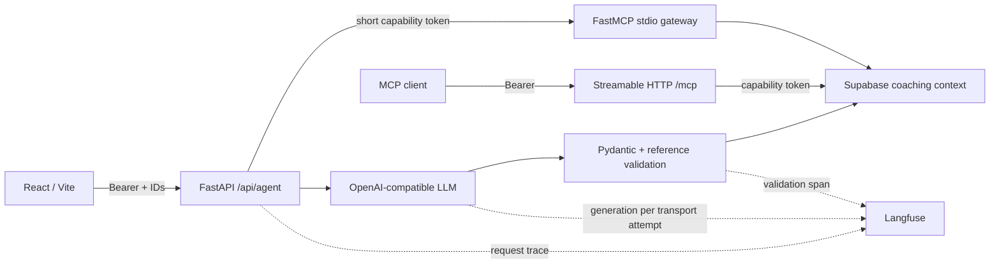
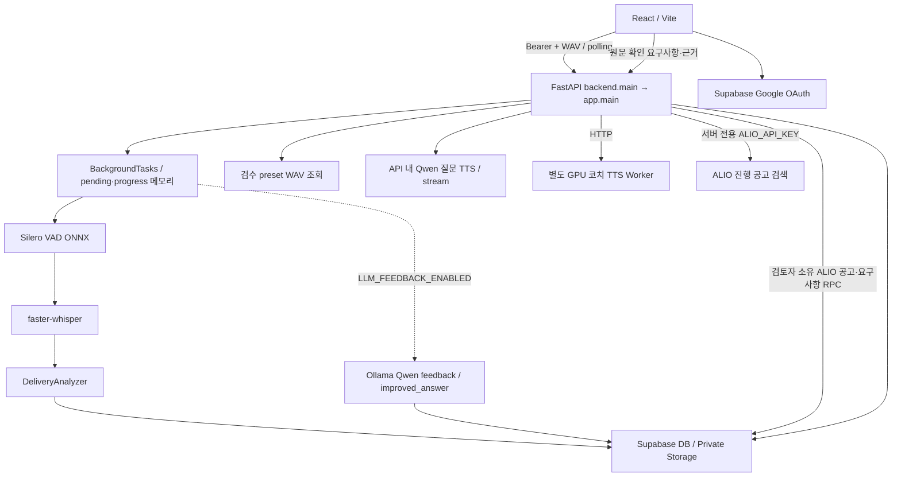
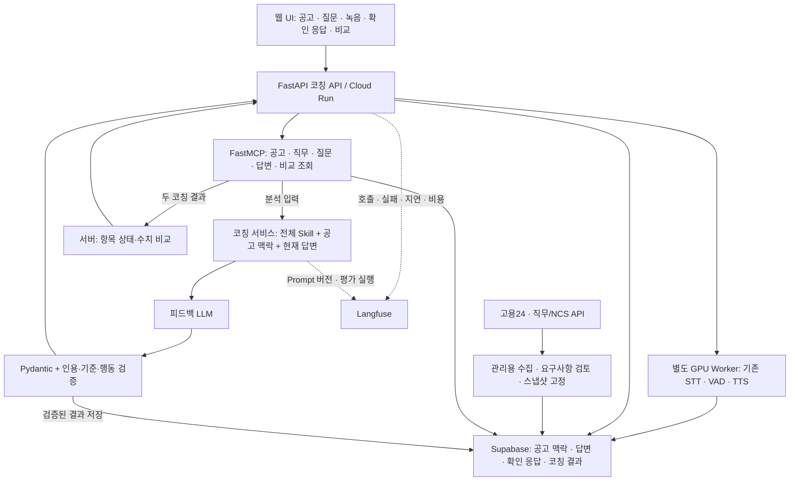

# Architecture

## 2026-09-30 사람인 MCP + 잡코리아 Tavily 검색 모드

`JOB_SEARCH_PROVIDER=playmcp_tavily`에서는 FastAPI가 사람인 PlayMCP와 Tavily의 잡코리아 도메인 검색을 병렬 실행한다. Tavily에는 고정 검색어만 전달하고 개별 공고 URL만 후보로 사용한다. 두 출처 모두 기존 원문 검증과 근거 매칭을 통과해야 카드에 표시된다. [Spec](specs/playmcp-tavily-jobkorea-search.md).

## 2026-09-29 코칭 실패 진단

`/api/agent` 요청의 실패 단계와 계약 재시도 이력을 동일한 trace ID로 기록하고, Langfuse에는 원문 없는 구조화 metadata만 보낸다. 관측 장애는 코칭 응답을 바꾸지 않는다. [Spec](specs/coaching-failure-diagnostics.md).

## 2026-09-29 Prompt와 Skill 구성

서버 문맥 → `prompts/`의 운영 템플릿 + `skills/`의 도메인 규칙 → LLM → 기존 Pydantic·근거 검증 순서다. Prompt는 역할·입력 취급·응답 형식과 계약 점검을, Skill은 판정 기준·허용 근거·질문 우선순위를 관리한다. 코칭 loader의 `rules_text`는 최종 Prompt가 아니라 규칙 묶음이다. README·공고 분석 loader는 front matter를 제외한 Skill 본문을 실제 모델 입력에 넣는다.

Langfuse의 템플릿도 같은 방식으로 현재 Skill과 결합하며 Skill 슬롯 없는 원격 완성 Prompt는 로컬로 fallback한다. API의 문맥 조회·MCP·provider·서버 검증 순서는 바뀌지 않는다. [Spec](specs/prompt-skill-separation.md).

## 2026-09-28 사람인 상세 본문 검증

추천·선택 검증은 사람인 `user_content`의 상세 텍스트를 분석에 사용한다. script/style/noscript와 영역 밖 안내문은 제외한다. 본문이 이미지뿐이거나 20자 미만이면 추천하지 않으며 선택 시 모델·목록·저장 전에 거부한다. 구형 페이지는 기존 상세요강~근무지위치 범위를 쓰되 개인정보/복리후생 안내 시작점에서 자른다. OCR과 요구사항 추측은 추가하지 않는다.

## 공통 LLM transport (2026-09-28)

OpenAI SDK Chat Completions의 raw response를 기존 JSON·usage 처리에 연결한다. OpenRouter 옵션은 extra_body로 전달하며 SDK 재시도와 서버 전송 정책을 중복 실행하지 않는다.

## 비교 후 면접 대화 API

Bearer + 세션 ID → FastAPI `/api/agent/chat` → 사용자 JWT/RLS의 기존 두 확정 답변·코칭 조회 → 서버 동일 기준 비교 → 면접 대화 Skill/JSON provider → 출력 검증 → 짧은 답변·꼬리질문 하나 또는 종료 요약. 문맥·이력을 브라우저에서 받거나 기존 판정을 수정하지 않는다. 최근 12메시지/4000자 요약, 단일 worker 임시 메모리를 사용한다. 새로고침·서버 재시작은 새 대화를 시작하며 다중 worker 복원은 미지원이다.

> PR #7 충돌 해결 시점의 최신 main(`0b8fcff`)에는 이후 코칭 구현이 추가되어 있다. 아래 조사는 `73525a1` 시점의 기록이며 최신 코칭 계약·구현 현황은 [저장소 구현 점검표](repository-audit.md)와 [코칭 런타임 계약](specs/coaching-skill-runtime.md)을 함께 확인한다. 이번 작업은 후속 구현의 전체 재감사를 수행하지 않았다.

> 2026-09-17 이관 코드 정적 조사. 현재 구조는 호출 경로 기준이며 서비스 실행 증거가 아니다. [현재 상태](CURRENT_STATE.md)의 제한을 함께 읽는다.

## 2026-09-21 코칭 런타임 구조

- `/api/agent`는 서버 ID만 받고 stdio MCP로 질문·답변 revision·검토 공고를 읽는다. HTTP `/mcp`는 이 세 문맥 조회와 저장된 1차·2차 코칭 결과 비교까지 네 읽기 도구를 제공하지만 코칭 내부 경로를 아직 대체하지 않는다. 비교 도구는 사용자와 두 결과 ID에 묶인 별도 capability token을 검증하고 추가 LLM 호출 없이 서버에서 계산한다.
- `/api/agent`는 본문 계약과 분리해 opaque `X-Trace-Id`와 실제로 성공한 stdio 도구명만의 `X-MCP-Tools`를 반환한다. 원문·JWT·capability token·도구 payload는 반환하지 않는다.
- LLM 전송 재시도와 출력 계약 재시도는 별도 상한을 가지며 provider usage 비용 상한도 요청 단위로 적용한다.
- Langfuse generation·span에는 redacted 구조 요약과 model·token·cost·latency·재시도·버전만 기록한다. 원문 답변·전사·공고·URL·인용·token은 관측 경계를 넘지 않는다.
- 이 구조는 Docker 자동 테스트로 검증했으며 실제 외부 LLM·운영 Supabase JWT·운영 Langfuse·배포 동작 증거는 아니다.

## 2026-09-17 기준 기존 구조 조사

- 진입점: [frontend/src/main.tsx](../frontend/src/main.tsx), [backend/main.py](../backend/main.py), [backend/app/main.py](../backend/app/main.py).
- 분석: [persistent_analysis_jobs.py](../backend/app/services/persistent_analysis_jobs.py). STT/VAD는 현재 API 프로세스의 background task 안에서 호출된다. 별도 STT Worker 분리는 목표와 구분한다.
- persistent STT는 연습 세션의 검수 공고 제목·선택 요구사항·직접 입력 질문에서 allowlist 기술용어를 최대 12개 추출해 optional `initial_prompt`로 전달한다. 문맥 조회 실패나 매칭 없음은 no-prompt STT로 fallback하며 상세 계약은 [STT 동적 initial prompt Spec](specs/stt-dynamic-initial-prompt.md)을 따른다.
- 저장: 사용자 JWT로 DB·Storage에 접근, 결과는 영속화하지만 임시 음성·pending·progress는 로컬/메모리다. 설정 부족 시 로컬 job service를 선택해도 API 인증은 유지한다.
- 음성: preset WAV 조회, API 내 질문 합성, [코치 TTS Worker](../backend/tts_worker/app/main.py)의 세 경로가 공존한다. API 전체가 GPU-free라고 단정할 수 없다.
- ALIO 검색·검토: 로그인 사용자의 `GET /api/alio/recruitments`만 서버가 처리하며 `ALIO_API_KEY`는 브라우저에 보내지 않는다. 사용자가 검색 결과의 원문을 확인하고 요구사항·근거를 입력하면 `POST /api/alio/recruitments/review` → `review_alio_recruitment` RPC가 검토자 소유 `alio` 공고·요구사항을 원자적으로 만든다. 원문은 ALIO가 가리킨 기관 채용 사이트일 수 있다.
- 연습 조건: RLS와 `create_practice_session`은 기존 검토 공고를 유지하면서, `alio` 공고만 `reviewed_by_user_id = auth.uid()` 조건으로 열람·세션 생성을 제한한다. 팀 공용 검토 역할은 없다.
- 배포 설정: Compose는 API + Nginx frontend 두 서비스. TTS Worker·Supabase·Ollama는 외부 설정 대상. Frontend Vercel 설정은 있지만 Cloud Run 배포 성공 증거는 없다.
- 당시 API: `/health`, `/analysis-jobs`, `/practice-records`, `/api/preset-questions/{question_id}/audio`, 질문·코치 TTS. 당시 `/api/agent` 및 HTTP `/mcp`는 연결되지 않았다.
- 당시 [LLM 서비스 자리](../backend/services/llm.py)와 [MCP 예시](../mcp_server/server.py)는 scaffold였다. 현재 코칭 구현은 위 2026-09-21 섹션과 [현재 상태](CURRENT_STATE.md)를 따른다.

## Target Architecture

## Service Boundaries

### Web UI
- 공고 선택
- 질문 선택/입력
- 녹음
- 전사 확인
- 코칭 결과
- 확인 응답
- 행동 선택
- 1차/2차 비교

### FastAPI Coaching API
- 사용자 인증 문맥
- 세션 공고 고정
- 답변 revision 확정
- LLM 호출 orchestration
- 결과 검증/저장
- 비교 응답

### GPU Worker
- 기존 STT
- 기존 VAD
- 기존 TTS
- 코칭 컨테이너에서 GPU 모델을 다시 로드하지 않음

### FastMCP
읽기 전용 중심:
- 공고 맥락
- 직무 정의
- 질문/활성 기준
- 확인된 답변
- 비교 대상 결과

### Coaching Service
`generate_feedback(context, schema)` 같은 단일 경계에서 모델 공급자 호출을 수행한다.

외부에서 처리할 것:
- MCP 조회
- 인증/소유자 검사
- Pydantic 검증
- 인용 검증
- 저장
- 재답변 상태 비교

### Supabase
- 공고 스냅샷/요구사항
- 답변 revision
- 코칭 결과
- 확인 응답/선택 행동
- 실행 상태
- 만료/삭제 연결

### Langfuse
- trace
- Prompt 버전
- 모델/지연/비용/오류
- 평가 실험

## API Boundary Draft

- `GET /api/job-postings`
- `POST /api/attempts/{attempt_id}/context`
- `POST /api/attempts/{attempt_id}/confirm`
- `POST /api/agent` (`analyze`)
- `POST /api/coaching-runs/{run_id}/practice-plan`
- `POST /api/agent` (`compare`)
- `GET /api/coaching-runs/{run_id}`
- `GET /health`
- `GET /docs`
- `/mcp`

## Current Architecture 후속 검증

실제 로그인·RLS·음성 추론·TTS 스트림·재시작 복구·만료/삭제·배포 검증은 미수행이다. 특히 DB 영속화와 작업 재개 보장은 다르며, 목표의 단일 코칭 계층·독립 GPU 경계는 기존 호출 경로를 확인하며 단계적으로 적용한다.

### 2026-09-23 GitHub README 분석 경계

NCS 자기점검을 마친 로그인 사용자가 README 링크를 제출하면 React 채팅이 Bearer 토큰과 링크를 `POST /api/github/readme/analyze`로 보낸다. FastAPI는 허용된 GitHub URL을 파싱하고 고정된 `api.github.com` README/contents API에서 공개 Markdown을 조회한다. 서버의 OpenRouter 호환 provider가 `google/gemini-3.8-flash`에 원문을 보내고, Pydantic 출력 형식과 항목별 원문 근거 포함 여부를 확인한 결과만 브라우저에 반환한다.

README 원문·분석 결과는 현재 DB에 저장하지 않으며 공고 요구사항이나 코칭 입력으로 연결하지 않는다. `OPENROUTER_API_KEY`는 서버에서만 사용한다. 팀 README 분석은 프로젝트 설명의 근거이며 개인 기여 판정은 아니다.

README 분석 요청만 모델 출력 한도를 3,072토큰으로 지정한다. GitHub 일시 오류는 한 번 재시도하고, 모델 근거는 Markdown 강조·백틱을 제거한 README의 연속 문구와 대조한다. 최종 분석에서 근거가 없는 항목은 제외하되 검증된 기술과 흐름이 각 한 개 이상 있어야 한다. 공고 추천은 동일한 README 근거 규칙으로 제출된 분석을 다시 확인한다.

### 2026-09-23 민간 채용 사이트 웹검색 추천 경계

React 채팅은 현재 NCS 선택 ID와 README 분석 결과(건너뛴 경우 없음)를 인증된 `POST /api/job-search/recommendations`에 보낸다. 서버는 ID 목록과 README SHA·인용을 원문과 대조한 뒤 OpenRouter 웹검색 도구로 사람인·잡코리아 공고를 각각 찾는다. Google 검색 citation의 중간 주소는 한 번만 해석하며, 최종 주소가 허용된 개별 공고인 경우에만 다시 조회한다. 현재 원문에서 마감일과 기술·프로젝트 흐름·NCS 문구의 겹침을 확인하고, 동일 기업·유사 제목의 교차 출처 중복을 제거해 최대 3건을 정렬한다. 카드에는 일치 항목을 짧게 표시하고 원문 인용은 표시하지 않는다.

기본 웹검색은 이번 달과 다음 달을 함께 찾는다. 검증된 후보가 0건이면 OpenRouter Exa 웹검색을 두 채용 사이트의 도메인으로 제한해 먼저 한 번 실행한다. 이후에도 3건보다 적거나 한 출처만 남으면 다른 기술·직무 키워드로 보완 검색을 수행한다. 모든 후보에 같은 URL 허용 목록·원문 검증·중복 제거를 적용한다. URL 경유 해석과 후보 원문 검증은 각각 제한된 수의 동시 요청으로 처리한다. 역량 겹침은 확인된 공고 제목과 상세 본문에서 찾는다.

검색 후보는 선택 전까지 저장·코칭 입력에 연결되지 않는다. 사용자가 `공고 선택`을 누르면 인증된 서버가 원문 상태와 상세 내용을 다시 확인하고 기존 요구사항 분석기로 AI 인용을 원문에 대조한다. 통과한 항목만 소유자별 `private_job` 검토 공고로 저장한다. 해당 공고는 기존 요구사항 선택 → 질문 → 1차 답변·코칭 → 2차 답변·비교 경로를 사용한다. DB 정책은 다른 사용자의 민간 공고·요구사항·세션 접근을 차단한다. 웹검색과 요구사항 분석에는 모델 토큰 및 검색 비용이 발생할 수 있으며, 일시적인 상위 오류에는 한 번 재시도한다.

OpenRouter 웹검색 요청은 출처별로 1,536토큰 출력 상한을 둔다. 이는 모델의 기본 최대 출력 비용으로 인한 사전 402를 피하기 위한 설정이며 실제 계정 크레딧을 대신하지 않는다. 402는 계정 크레딧·키 사용 한도 오류로 구분한다. 한 출처의 오류가 다른 출처의 유효 인용을 가리지는 않는다.

### 지원 자료 세션 snapshot

연습 시작 시 frontend → 신규 세션 RPC → `practice_sessions.applicant_context`에 검증된 README·확인 이력서·NCS 선택을 원자적으로 저장한다. 기존 소유자/만료 검사를 거쳐 MCP JobContext 및 면접 대화 입력에 참고 자료로 전달하며, 답변 인용 근거를 대신하지 않는다. 기존 세션 RPC는 유지한다.

## 준비·1차 코칭 대화
`/api/agent/preparation` → 인증 → 사용자/만료 제한 상태 조회 → Gemini 3.5/고정 Prompt·Skill → server policy → version CAS 저장 → 답변/질문 표시. `/bind`는 소유 세션을 확인해 준비 대화를 같은 연습에 고정한다. 새 테이블은 사용자 읽기만 허용하고 서버가 쓰며 접근 24시간·정기 삭제를 적용한다. 코칭과 비교 후 대화는 같은 세션의 저장 완료 경력만 참고 자료로 읽는다. 원래 답변 revision과 평가 근거를 대체하지 않는다.
