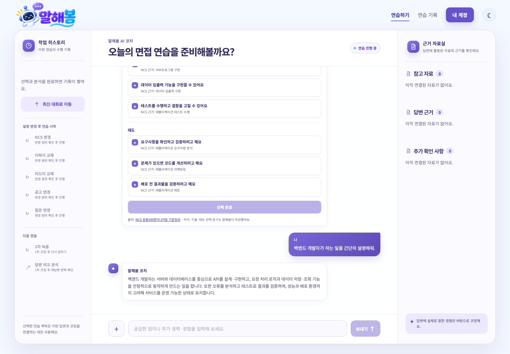

# 운영 HTTP 요청과 Langfuse trace 직접 연결 증거

2026-10-09 10:37 KST에 `https://malhaebom.xyz`에서 검증했다. 브라우저 요청을 가로채거나 응답을 대체하지 않았다.

## 배포 기준

- Cloud Run 서비스: `malhaebom-mk2` / `asia-northeast3`
- 운영 revision: `malhaebom-mk2-request-trace-linkage-1009`, 트래픽 100%
- 이미지: `sha256:fbfb2840cd3d3190d321cfb2a2c86af8931f5970cdca8e884ceaa31fc17b7465`
- 사이트의 API: `https://malhaebom-mk2-909028462046.asia-northeast3.run.app`
- 같은 서비스의 API 별칭: `https://malhaebom-mk2-fmf5h3xp4q-du.a.run.app`
- 직전 운영 이미지 `sha256:d3cd9b7d941eac39fb04f96e211bf6882b8291454050f7b0d3bfcad67a3663d1`에 관측 코드만 추가했다. 프런트엔드·Prompt·Skill·모델을 변경하지 않았다.

## 실제 요청 결과

| 요청 | HTTP | 응답 X-Trace-Id = X-Request-Id = Langfuse trace ID | 관측 |
| --- | --- | --- | --- |
| 사이트 입력창에 “백엔드 개발자가 하는 일을 간단히 설명해줘.” 전송 | 200 | `0c75784da51d4896aa10acfd26d4dad0` | http.request 1개, preparation.chat 1개, 실제 GENERATION 1개 |
| 같은 사이트의 브라우저 fetch로 필수 필드를 빠뜨린 요청 전송 | 422 | `7cf42ba8fa8f4eadaa926a10bc54fedc` | http.request 1개, GENERATION 0개 |

[성공 trace](https://jp.cloud.langfuse.com/project/cmuajvd4n00c9ad0c18ctq838/traces/0c75784da51d4896aa10acfd26d4dad0) · [입력 오류 trace](https://jp.cloud.langfuse.com/project/cmuajvd4n00c9ad0c18ctq838/traces/7cf42ba8fa8f4eadaa926a10bc54fedc)

[증거 JSON](../../evals/results/request-trace-linkage-20261009/evidence.json)에 응답 헤더, Langfuse observation ID·trace ID, Cloud Run 로그와 revision, 정리 결과를 보존했다. Langfuse 열람은 프로젝트 접근 권한이 필요하다.

두 요청 모두 Cloud Run 로그의 `request_trace_link request_id=… trace_id=…` 값이 응답 헤더와 정확히 같고, 로그의 `revision_name`도 위 revision이다. 단순 시각 대조가 아닌 ID 직접 연결이다.

성공 응답은 화면에도 표시됐다. 오류 요청은 스키마 검증 실패이며 모델 출력 실패가 아니다. 브라우저 JavaScript에서도 `response.headers.get('X-Trace-Id')`로 422 ID를 읽었다.

## 재현 방법과 연결 단위

1. 로그인 상태에서 채팅을 전송하고 브라우저 Network에서 해당 POST 응답의 `X-Trace-Id`를 복사한다.
2. Langfuse의 해당 trace를 열거나 Public API로 같은 `traceId`의 observations를 조회한다.
3. `http.request`의 request_id·method·path·http_status와 HTTP 응답을 대조하고, Cloud Run 로그에서 같은 ID와 revision을 확인한다.

조회에는 [Langfuse Public API](https://langfuse.com/docs/api-and-data-platform/features/public-api)의 `/api/public/v2/observations`에 `traceId`, `fields=core,basic,metadata`, 조회 시간 범위를 지정했다. 인증값은 증거에 포함하지 않는다.

서버는 `/api/agent`, `/api/agent/preparation`, `/api/agent/chat`의 각 HTTP 전송에 새 ID를 부여한다. 한 전송의 모델 호출·내부 재시도는 같은 trace를 사용하고, 다시 보내기는 새 ID를 갖는다. 본문의 `request_id`는 논리적 중복 처리 키로, 헤더 ID와 별개다.

## 검증 범위와 남은 항목

- 임시 실제 인증 세션을 브라우저 저장소에 주입했다. OAuth 로그인 화면 자체는 검증하지 않았다.
- 임시 세션을 폐기하고 테스트 사용자와 로컬 인증 파일을 삭제했다.
- 마이크·STT·전체 면접 흐름·사람의 응답 품질 평가는 이번 검증에 포함하지 않았다.
- 헤더가 존재해도 관측 전송 장애가 생기면 Langfuse에 기록되지 않을 수 있다. 이번 두 요청은 실제 API 조회까지 확인했다.
- 현재 GitHub main에는 운영 이미지 전체를 가져오지 않고 같은 관측 변경만 적용했다. 운영 배포 증거와 PR 소스 테스트를 구분한다.
